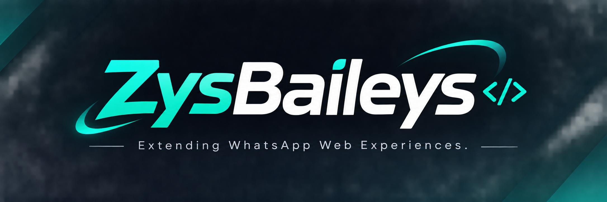

 <div align="center">
 
  
  <h3>Extending WhatsApp Web Experiences.</h3>

  <p>
    An experimental Baileys fork focused on extended messaging capabilities,
    interactive experiences, and custom WhatsApp Web functionality.
  </p>

  <p>
    
    
    
    
  </p>
</div>

---

## About

**ZysBaileys** is an experimental fork of [Baileys](https://github.com/WhiskeySockets/Baileys), a WebSockets-based TypeScript library for interacting with the WhatsApp Web API.

This fork explores additional messaging capabilities, custom message structures, and interactive experiences while maintaining the familiar Baileys development workflow.

## Features

- **Rich Response** — Extended WhatsApp messages with formatted content and code blocks.
- **HTML App** — Experimental HTML-based interactive experiences.
- **Native Flow** — Experimental support for interactive native-flow messages.
- **Baileys Compatibility** — Built on the Baileys codebase and its existing messaging architecture.

## Installation

Install ZysBaileys directly from GitHub:

```bash
npm install github:Kamzy-yaw/zys-baileys
```

Or add it to your `package.json`:

```json
{
  "dependencies": {
    "@whiskeysockets/baileys": "github:Kamzy-yaw/zys-baileys"
  }
}
```

## Quick Start

```js
import makeWASocket from '@whiskeysockets/baileys'

const sock = makeWASocket({
    // Your connection configuration
})

sock.ev.on('connection.update', (update) => {
    console.log('Connection update:', update)
})
```

For authentication, message handling, and advanced usage, refer to the documentation inherited from the original Baileys project.


## Project Status

ZysBaileys is actively experimental. Features may change, behave differently across WhatsApp clients, or require further testing.

## Disclaimer

ZysBaileys is an unofficial, independently maintained fork. It is not affiliated with, endorsed by, or officially connected to WhatsApp, Meta, or WhiskeySockets.

Use this project responsibly and comply with WhatsApp's Terms of Service. Do not use it for spam, abusive automation, or unauthorized activities.

## Credits

ZysBaileys is based on [WhiskeySockets/Baileys](https://github.com/WhiskeySockets/Baileys).

Original project contributors retain their respective copyright notices. See the license information below.

---
